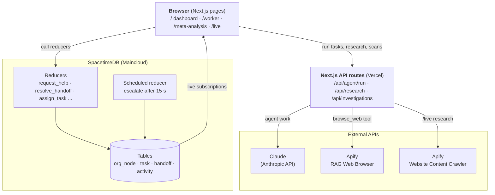

# Spacetime Org

**A live org chart for hybrid human + AI teams.** Built at CalHacks 2026.

**Live demo:** https://spacetime-org.vercel.app

Companies are starting to staff teams with a mix of people and AI agents. Spacetime Org models that org as one hierarchy. **Leads** manage **Workers**, and Workers manage **Agents**. You can see who reports to whom, hand tasks to agents, run those agents against Claude, and track how they're performing.

## Demo logins

Every page sits behind a login (`/login`). The role decides what you see:

| Account | Email | Password | Sees |
| --- | --- | --- | --- |
| CEO (Avery Chen) | `ceo@spacetime.org` | `ceo-demo` | The whole org |
| Engineering Lead (Sam Patel) | `lead@spacetime.org` | `lead-demo` | Only their own workers and agents |

The scoping lives in `useOrgData`, so the org tree, Worker Workspace, and AI Usage page all respect it. Sessions are an HMAC-signed cookie (`lib/session.ts`); set `AUTH_SECRET` in production. Accounts are in `lib/auth.ts`.

## Features

- **Org topology dashboard** (`/`): a pannable, zoomable tree of Leads → Workers → Agents.
  - Add, edit, and search nodes, filter by node type, and see live status colors (Active / Idle / Busy / Offline).
  - Reassigning a node only offers valid superiors, so you can't create a reporting cycle.
  - Create and edit tasks, then run a task through an agent. The agent's status changes to *Busy* while it runs, and the task is checked off when it finishes.
- **Worker portal** (`/worker`): pick a Worker, then see their tasks and the agents assigned to them. You can send an agent a custom prompt and read its output.
- **Meta-analysis** (`/meta-analysis`): telemetry for every agent run, including tokens used, latency, and success count. It refreshes every 3 seconds.
- **Live mode** (`/live`): an org chart, an activity feed, a human inbox, and demo controls, all wired to the SpacetimeDB backend (see below).
- **Agent execution API**: `POST /api/agent/run` sends a prompt to Claude through the Anthropic SDK. It can add a simulated delay first, and it records telemetry for each run.

### SpacetimeDB backend: human-in-the-loop escalation

The `org-backend/spacetimedb` module stores the org in real-time tables: `org_node`, `task`, `handoff`, `activity`, and `escalation_timer`. Its most interesting logic is how it escalates questions:

1. A stuck agent calls `request_help`. The agent is paused (`BLOCKED_BY_HUMAN`), and a handoff opens for its manager.
2. A scheduled timer starts. If nobody answers within **15 seconds**, `escalate` moves the handoff up to the next manager in the chain, repeating until it reaches the top of the org.
3. When a human answers through `resolve_handoff`, the handoff closes and the agent goes back to `WORKING`.

`reset_demo` wipes the tables and loads a small sample org: a VP, a manager, and two agents.

### Apify: agents can see the web

Every agent in the org can browse the live web. When a task needs real-world facts (a company, its competitors, pricing, news, docs), the agent **decides on its own** to call a `browse_web` tool. That tool hires the [Apify RAG Web Browser Actor](https://apify.com/apify/rag-web-browser), which searches Google or opens the URL and returns clean markdown of the top pages. The agent writes its report from that evidence and cites the pages it read.

- Code: `lib/apifyWebTool.ts` (the tool + Claude tool-use loop), used by `POST /api/agent/run`.
- Each answer that used the web ends with **🌐 Web research via Apify** and the URLs read, so humans can check the evidence.
- Tasks that don't need the web (e.g. "write a thank-you email") never call Apify.
- `/live` also has a **🔍 Research** box: Apify's Website Content Crawler reads a company site, Claude summarizes it, and if something is unclear the agent pauses and opens a SpacetimeDB handoff to its human manager (`app/api/research`, `components/ResearchPanel.tsx`).

**Try it:** select an agent (click one of the small dots on a card), add the task *"Find 3 competitors of Notion and compare their pricing"*, then click **⚡ Run Agent**.

## Architecture



- **SpacetimeDB** holds the shared, live state: every browser subscribes to the same tables, and escalation runs inside the database as a scheduled reducer.
- **Next.js API routes** keep API keys on the server: they call Claude for agent work and Apify when an agent needs the web.
- **Telemetry** (tokens, cost, latency) is kept in server memory and shown on Meta Analysis.

## Tech stack

- [Next.js 16](https://nextjs.org) (App Router) + React 19 + TypeScript
- Tailwind CSS v4
- [SpacetimeDB](https://spacetimedb.com) 2.x (real-time database + server module, hosted on Maincloud)
- [Anthropic SDK](https://github.com/anthropics/anthropic-sdk-typescript) for agent runs
- [Apify](https://apify.com) Actors (RAG Web Browser, Website Content Crawler) as the agents' web tool

## Project structure

```
app/
  page.tsx              # main org topology dashboard
  worker/               # worker portal
  meta-analysis/        # agent telemetry dashboard
  live/                 # SpacetimeDB-backed live view
  edit/                 # simple org editor (local state)
  api/
    agent/run/          # runs a prompt against Claude, records telemetry
    telemetry/          # returns recorded agent runs
components/             # org chart, inbox, providers, demo controls
hooks/useOrgData.ts     # org/task state (SpacetimeDB tables, or a demo dataset)
lib/
  module_bindings/      # generated SpacetimeDB client bindings
  telemetryStore.ts     # in-memory telemetry store
org-backend/
  spacetimedb/src/      # SpacetimeDB server module (tables + reducers)
```

## Getting started

### Prerequisites

- Node.js 20+
- An [Anthropic API key](https://console.anthropic.com/), for running agents
- *(Optional)* The [SpacetimeDB CLI](https://spacetimedb.com/install), needed only to publish or modify the backend module

### 1. Install dependencies

```bash
npm install
```

### 2. Set your API key

Create a `.env.local` file in the project root:

```bash
ANTHROPIC_API_KEY=sk-ant-...
APIFY_TOKEN=apify_api_...
NEXT_PUBLIC_SPACETIMEDB_HOST=wss://maincloud.spacetimedb.com
NEXT_PUBLIC_SPACETIMEDB_MODULE=org-backend-afa0s
```

Never commit `.env.local`. Without `APIFY_TOKEN`, agents still run but can't browse the web.

### 3. Run the dev server

```bash
npm run dev
```

Open [http://localhost:3000](http://localhost:3000). The dashboard loads a demo org dataset right away, so no database setup is needed to try it. Agent runs need the API key from step 2.

### Production build

```bash
npm run build
```

```bash
npm start
```

## Working on the SpacetimeDB backend (optional)

The server module lives in `org-backend/spacetimedb`. `org-backend/spacetime.json` points it at the Maincloud server.

```bash
cd org-backend/spacetimedb
```

```bash
npm install
```

```bash
spacetime login
```

```bash
spacetime publish
```

After you change any tables or reducers, regenerate the TypeScript client bindings with `spacetime generate` and output them into `lib/module_bindings/`.

The client connects to the database set by `NEXT_PUBLIC_SPACETIMEDB_HOST` / `NEXT_PUBLIC_SPACETIMEDB_MODULE` (we use `org-backend-afa0s` on Maincloud), read in `components/LiveSpacetimeProvider.tsx`. That name matches `org-backend/spacetime.local.json`. If you publish under a different name, update both.

## Notes

- Agent telemetry is stored in memory on the Next.js server, so it resets when the server restarts.
- `/api/agent/run` runs each agent on its assigned Claude model and adds the Apify `browse_web` tool when `APIFY_TOKEN` is set.
- `/api/chat` and `/api/reset` are placeholders.
